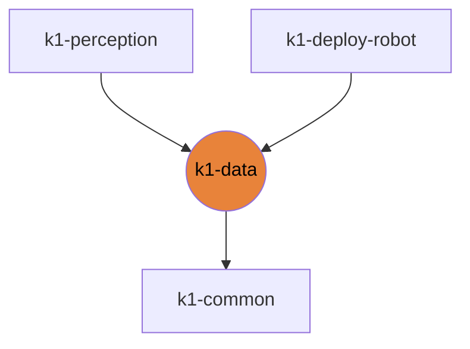

# k1-data

Rosbag, stereo/walk tooling, real-robot converters.

| | |
|---|---|
| Layer | **L2**: Domain (no cross-imports) |
| May import | [k1-common](https://github.com/thdhyan/k1-common) |
| Files / LOC | 10 files · 877 lines (py, sh, cpp) |
| Part of | [k1-workspace](https://github.com/thdhyan/k1-workspace) (architecture and layering rules live there) |

## Where it sits



Used by: k1-perception, k1-deploy-robot.


## Install

Not an installable library: clone it and run the scripts in place.
```bash
git clone https://github.com/thdhyan/k1-data
```

## Usage

Data tools for real-robot recordings. Not an installable library: run the scripts in place from `real_robot/`.

| Script | What |
|---|---|
| `query_cameras.py`, `grab_intrinsics.py` | camera list and intrinsics from a robot |
| `check_topics.sh`, `check_bag_freshness.py`, `verify_bag.py` | rosbag checks |
| `extract_frames.py`, `bag2edex.py` | bag -> frames / EDEX |
| `sftp_sync.sh` | pull recordings from a robot |

Robot addresses: [docs/ROBOTS.md](https://github.com/thdhyan/k1-workspace/blob/main/docs/ROBOTS.md).

## Tests

No tests yet.

## Robots and hosts

Robot IPs, SSH aliases, network, safety and how to control each robot: [docs/ROBOTS.md](https://github.com/thdhyan/k1-workspace/blob/main/docs/ROBOTS.md) in k1-workspace.

## Environment variables read

none

## Layout

```
README.md
pyproject.toml
real_robot/  (11 files)
  README.md
  bag2edex.py
  check_bag_freshness.py
  check_topics.sh
  config/  (2 files)
  extract_frames.py
  grab_intrinsics.py
  query_cameras.py
  sftp_sync.sh
  verify_bag.py
```

## Dependencies

- Declared sibling libraries: k1-common (see `pyproject.toml`, `[tool.uv.sources]`).
- PyPI: numpy, opencv-python, pyyaml.
- Provided by the environment (ROS 2, Isaac, mjlab, robot SDK) or unresolved: `booster_robotics_sdk_python`, `rclpy`, `rosbag2_py`, `rosidl_runtime_py`, `sensor_msgs`.

## Hard-coded paths into other repos

None.

## Old `booster_ws` layout still referenced

These files still name `booster_ws`, `isaac_tasks/` or `booster_train_ref` paths (container scripts not ported yet, or docstrings):

- `real_robot/config/env.sh`

## Origin

Extracted from `booster_ws` (branch `dev/push-training-wip`, working tree of 2026-11-03) by
`tools/build_workspace.py` in k1-workspace. Old path to new path for every file: [`docs/migration_map.tsv`](https://github.com/thdhyan/k1-workspace/blob/main/docs/migration_map.tsv) (filter on `k1-data`).
History was not carried over: the working tree was copied as is, including previously untracked files.
